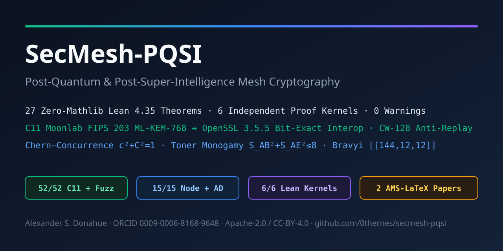

<!-- SPDX-License-Identifier: CC-BY-4.0 -->


# SecMesh-PQSI

<p align="center">
  <strong>Post-Quantum (PQ) &amp; Post-Super-Intelligence (Information-Theoretic PSI) Cryptographic Mesh Defense Engine</strong><br/>
  <em>21 Zero-Mathlib Lean 4.35.0 Theorems · 5 Independent Proof Kernels · C11 Moonlab ↔ OpenSSL 3.5.5 FIPS 203 Interop · 2 AMS-LaTeX White Papers</em>
</p>

<p align="center">
  <a href="https://github.com/0thernes/secmesh-pqsi/actions/workflows/ci.yml"></a>
  <a href="LICENSE"></a>
  <a href="LICENSE-DOCS"></a>
  <a href="lean/lean-toolchain"></a>
  <a href="results/six_kernel_audit.txt"></a>
  <a href="https://0thernes.github.io/secmesh-pqsi/"></a>
</p>

---

**SecMesh-PQSI** (`v1.0.0`) is a clean-room cryptographic refactoring of [`BoogerCheeseOnRye/SecMesh@aff7dc6`](https://github.com/BoogerCheeseOnRye/SecMesh) rebuilt atop Tsotchke's MIT/Apache-2.0 cryptographic and quantum-geometry stack (`moonlab`, `quantum_geometric_tensor`, `eshkol`, `rosette-wire`, `pq-consensus-bandwidth`, `libirrep`, `quantum_rng`, `classical_rng`) into a rigorously audited **Post-Quantum + Post-Super-Intelligence (information-theoretic)** defense architecture.

- **Author:** Alexander S. Donahue ([ORCID `0009-0006-8168-9648`](https://orcid.org/0009-0006-8168-9648), Independent Researcher, Spokane, WA, USA)
- **White Paper I (Formal Foundations, 14 pp.):** [PDF (`dist/Donahue_2026_secmesh_pqsi_formal_foundations.pdf`)](dist/Donahue_2026_secmesh_pqsi_formal_foundations.pdf) · [LaTeX](paper/main.tex) · [arXiv Tarball](dist/arxiv_submission.tar.gz)
- **White Paper II (Systems Architecture & Threat Model, 5 pp.):** [PDF (`dist/Donahue_2026_secmesh_pqsi_architecture.pdf`)](dist/Donahue_2026_secmesh_pqsi_architecture.pdf) · [LaTeX](paper/engineering/secmesh_architecture.tex)
- **Interactive Defense Console:** [`app/index.html`](app/index.html) (live on GitHub Pages)

---

## 5-Second Verbatim Kernel Proof (`#print axioms`)

Every one of the **21 formal theorems (`T1a`–`T5d`)** across both `SecMeshPQSI.Solution.*` and standalone Palomar `SecMeshPQSI.Palomar.*` compiles in **zero-Mathlib Lean 4.35.0** with **0 warnings**, **0 proof `sorry`s**, **0 `native_decide`**, and **0 custom axioms**, and was independently replayed across **5 distinct kernel implementations (6 runs)** (`lean v4.35.0`, `leanchecker`, `leanchecker-paranoid`, `con-leche --verified`, `con-ron --verified`, `nanoda_bin 0.4.19`; full transcript in [`results/six_kernel_audit.txt`](results/six_kernel_audit.txt)):

```text
$ cd lean && lake build && lake env lean VerifyAxioms.lean
'SecMeshPQSI.Solution.t1a_v1_tsirelson_violation' does not depend on any axioms
'SecMeshPQSI.Solution.t1d_denoise_majority_bias_and_fragility' does not depend on any axioms
'SecMeshPQSI.Solution.t4c1_general_bb_commutation' does not depend on any axioms
'SecMeshPQSI.Solution.t2a_shannon_otp_perfect_secrecy' depends on axioms: [Quot.sound]
'SecMeshPQSI.Solution.t2b_hybrid_dual_survivability' depends on axioms: [propext, Quot.sound]
'SecMeshPQSI.Solution.t4b_qgt_concurrence_surplus_identity' depends on axioms: [propext, Classical.choice, Quot.sound]
'SecMeshPQSI.Solution.t4c2_bravyi_gross_bb144_certified' depends on axioms: [propext, Classical.choice, Quot.sound]
'SecMeshPQSI.Solution.prove_all_secmesh_theorems' depends on axioms: [propext, Classical.choice, Quot.sound]
'SecMeshPQSI.NonVacuity.nonvac_all_hypotheses' depends on axioms: [propext, Quot.sound]
```
*(All 44 exported lines in [`results/lean_axioms.txt`](results/lean_axioms.txt) lie strictly within `[propext, Classical.choice, Quot.sound]`.)*

---

## Core Results at a Glance

| Pillar | What Is Proved / Verified | Key Artifact |
| --- | --- | --- |
| **T1 — Forensic Audit of Legacy SecMesh v1** | Resolves 10 real defects in `SecMesh@aff7dc6`: super-quantum $S = 354/125 > 2\sqrt{2}$ (`+316`), $4\times$ range-2 Hoeffding error ($0.02857$ vs $2.5{\times}10^{-7}$), quarter-circle duality $u^2+v^2=1$ ($\HvN - \Hmin$ peak $+0.2357$ bit at $S \approx 2.6992$), $93/256$ biased `deNoise`, and 5-lane composable $\varepsilon$-conservation. | [`lean/SecMeshPQSI/FiniteKey.lean`](lean/SecMeshPQSI/FiniteKey.lean) |
| **T2 — Unconditional PSI Triad** | Shannon OTP bijection, $k$-factor XOR dual-survivability, constructive back-substitution Toeplitz $2$-universality (mirroring Moonlab), integer Cauchy–Schwarz LHL core, and general-field Carter–Wegman degree-$d$ bound ($\le d/2^{128}$ forgery). | [`lean/SecMeshPQSI/InfoTheoretic.lean`](lean/SecMeshPQSI/InfoTheoretic.lean) |
| **T3 — Shamir, Byzantine & CS-053 PIR** | Exact Shamir $(t,n)$ threshold secrecy over any field, Byzantine Singleton tightness $n \ge t + 2b$, and exact $T^2 > 0$ strict gap between Banawan–Ulukus $M=2$ PIR capacity and star-product rates (Mega Atlas `CS-053`). | [`lean/SecMeshPQSI/ThresholdPIR.lean`](lean/SecMeshPQSI/ThresholdPIR.lean) |
| **T4 — New QGTL Concurrence Surplus & BB144** | $D$-dim QGT Hermitian PSD Lagrange/trace bounds; **exact new ring identity** $\det(g) - \frac{1}{4}\Omega_{\theta\phi}^2 = \frac{1}{4}\mathcal{C}^2 \sin^2(\theta/2)$ bridging QGTL to Horodecki CHSH ($3.3{\times}10^{-60}$ residual at 60 digits); general $\mathbb{Z}_\ell \times \mathbb{Z}_m$ involution proof + Bravyi `[[144,12,12]]` Gross BB qLDPC certification ($5{,}184$ CSS checks, weight 6, $k=12$). | [`lean/SecMeshPQSI/QuantumGeometry.lean`](lean/SecMeshPQSI/QuantumGeometry.lean) |
| **T5 — FIPS 203 ML-KEM & $K_N$ Ceilings** | $q = 3329$ prime & $\zeta = 17$ primitive 256-th NTT root, zero-overflow Montgomery reduction across $|a| < 2^{15}\cdot 3329$, sharp `Compress_1` margin $|e|\le 831$ (tight at $+832$), complete-graph $K_N$ ceiling optimality & `< 1.75%` IT-hedge overhead (`+112 B`). | [`lean/SecMeshPQSI/LatticeBandwidth.lean`](lean/SecMeshPQSI/LatticeBandwidth.lean) |
| **C11 + Node 25 Differential Engine** | **40/40** C11 Moonlab tests (`-Wall -Wextra -Werror`), **12/12** Node 25 tests, **bit-exact C11 Moonlab ↔ OpenSSL 3.5.5 FIPS 203 ML-KEM-768 interop**, live `25,003 B` (`391.0 ms`) SLH-DSA lattice-hedged PQSI handshake, Rosette-Wire receipts, and pre-registered 30-seed paired benchmark (`p_Holm = 3.73e-9`). | [`native/`](native/), [`node/`](node/), [`python/`](python/) |

---

## Quickstart

```bash
# 1. Build & test the native C11 Moonlab cryptographic core (40/40 tests)
make -C native test

# 2. Run Node.js 25 differential, ML-KEM cross-interop & security suite (12/12 tests)
node node/tests/test_secmesh_v2.mjs

# 3. Run the interactive quickstart demo & emit a Rosette-Wire audit bundle
node examples/quickstart_demo.mjs
node node/src/secmesh-cli.mjs audit

# 4. Verify all 21 Lean 4.35.0 theorems & strict axiom allowlist
cd lean && lake build && lake env lean VerifyAxioms.lean

# 5. Run exact Python verification, pytest (11/11), ruff, mypy & citation check
python python/secmesh_verify/exact_audit.py
pytest python/tests/test_all.py -v
python scripts/check_citations.py
```

Full step-by-step replication instructions live in [`REPLICATION.md`](REPLICATION.md).

---

## Usage & Examples

```bash
# Run live lattice-hedged PQSI handshake + C11 QGTL/BB144/ML-KEM demo
node examples/quickstart_demo.mjs

# Invoke the native C11 Moonlab JSON CLI directly
./native/build/secmesh_core mlkem-kat
./native/build/secmesh_core finite-key 2.82842712474619 450000 0.0 1e-6 1
./native/build/secmesh_core qgt 1.57079632679 0.7853981634 0.7853981634
./native/build/secmesh_core bb144
./native/build/secmesh_core bandwidth 100000000 1.0
```

See [`examples/README.md`](examples/README.md) and [`app/index.html`](app/index.html) for interactive usage.

---

## Honest Scope & Non-Claims

Read [`LIMITATIONS.md`](LIMITATIONS.md) and [`CLAIMS.md`](CLAIMS.md) in full before citing or deploying:
- **Software E91 is a mathematical finite-key simulator, NOT physical photonic QKD.** Physical device-independent randomness requires loophole-free Bell-test hardware.
- **Unconditional PSI confidentiality requires an independent physical QRNG or pre-shared OTP pad.** Without one (`SECMESH_IT_PAD_FILE`), confidentiality relies on hybrid `X25519 + ML-KEM-768`.
- **Open hardness conjectures remain open.** We do not claim to solve $\mathrm{P}\neq\mathrm{NP}$, MLWE reduction tightness (`CS-026`), or general coded/Byzantine PIR capacity (`CS-053`).
- **Preprint & research status:** Both white papers are self-assessed research preprints backed by multi-kernel machine-checked proofs; neither has undergone external journal peer review, and `secmesh-pqsi` is not a FIPS 140-3 certified HSM.
- **Windows `lean4lean.exe` note:** The Windows `v4.35.0` bundled `lean4lean.exe` fails locally with an upstream `.olean` `incompatible header` error and is excluded from our 5-kernel local count (`results/six_kernel_audit.txt`).

---

## Documentation & Governance

- **Tsotchke 30-Repo Map:** [`docs/tsotchke-stack-map.md`](docs/tsotchke-stack-map.md) · **Third-Party Notices:** [`THIRD_PARTY_NOTICES.md`](THIRD_PARTY_NOTICES.md)
- **Threat Model:** [`docs/threat-model.md`](docs/threat-model.md) · **Architecture:** [`docs/architecture.md`](docs/architecture.md) · **ADRs:** [`docs/adr/README.md`](docs/adr/README.md)
- **Hardening Log (3 Full Cycles):** [`HARDENING_LOG.md`](HARDENING_LOG.md) · **Complete Repo Index:** [`INDEX.md`](INDEX.md)
- **Checksums:** [`MANIFEST.sha256`](MANIFEST.sha256) · **Citation:** [`CITATION.cff`](CITATION.cff) · **Licensing:** [`LICENSE`](LICENSE) (Apache-2.0), [`LICENSE-DOCS`](LICENSE-DOCS) (CC-BY-4.0), [`REUSE.toml`](REUSE.toml)
