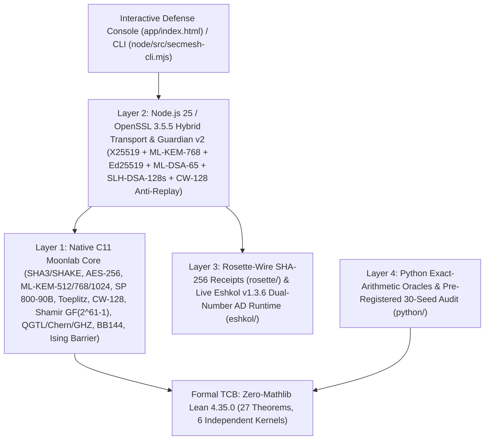

# System Architecture (`docs/architecture.md`)

`secmesh-pqsi` is organized into four cleanly separated trust layers so every cryptographic operation can be differentially checked across independent implementations and traced back to a machine-checked Lean 4.35.0 theorem.

## Layer Summary
1. **Layer 1 (`native/`):** Zero-warning C11 (`-std=c11 -D_DEFAULT_SOURCE -O2 -Wall -Wextra -Werror`) combining 18 vendored MIT files from `tsotchke/moonlab@cd3b234` with SecMesh-PQSI's entropy health gate, GF($2^{128}$) Carter–Wegman IT-MAC, Mersenne $\mathbb{F}_{2^{61}-1}$ Byzantine Shamir sharing, exact KL-Chernoff Finite-Key v2, QGTL entanglement surplus + Chern–Concurrence–GHZ (`T4d`–`T4e`) witness, Bravyi `[[144,12,12]]` qLDPC verifier, Ising expander contagion barrier (`T6a`), and $K_N$ bandwidth profiler.
2. **Layer 2 (`node/`):** Hardened Node.js 25 transport pairing OpenSSL 3.5.5 FIPS 203/204/205 primitives with C11 differential checks, length-prefixed canonical transcripts, sequence-bound anti-replay CW-128 framing (`[seq_u64be || tag16 || payload]`, 64 KiB cap, loopback CORS, zero raw key material in `/status`, zero UDP echo, collision-free ephemeral UDP bind), `T6b` threshold-hedged XOR signing nonces, and deterministic seeded health-field defense telemetry.
3. **Layer 3 (`eshkol/`, `rosette/`):** 4 live-executed Eshkol v1.3.6 forward-mode dual-number automatic differentiation modules (`finite_key_ad.esk`, `qgt_geodesic.esk`, `bandwidth_opt.esk`, `chern_ising_ad.esk`) evaluated via `node/src/eshkol-ad-runtime.mjs` plus Rosette-Wire verifiable SHA-256 Merkle receipt bundles.
4. **Layer 4 (`lean/`, `python/`):** 27 zero-Mathlib Lean 4.35.0 theorems (`T1a`–`T7b`, 14 `.lean` files) replayed across all 6 distinct independent kernels (CI `lake comparator --paranoid`) plus 60-digit Decimal Python exact-arithmetic verification and 5 publication vector PDF figures.
